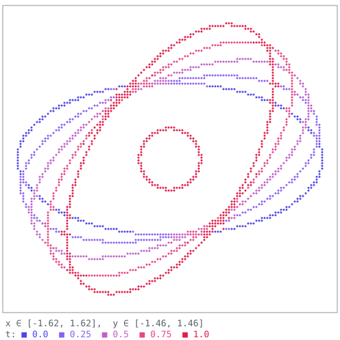
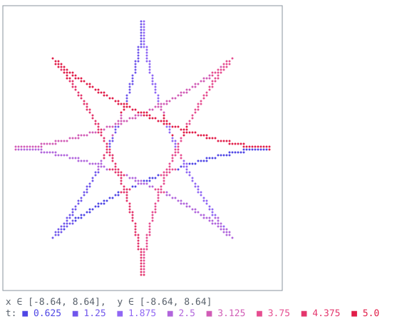
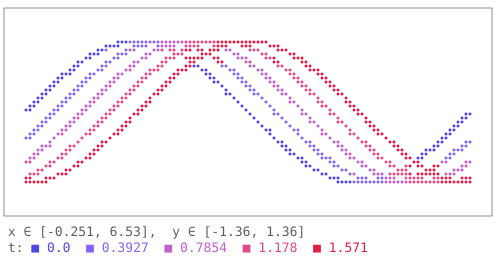

# DotPlots.jl

Plots in the terminal, in Unicode Braille characters (2 × 4 dots each, about square, so shapes keep their aspect
ratio), with no dependencies. `dotplot` draws plane curves at a sequence of times: overlaid, coloured by time when
the terminal shows colour, and, at an interactive terminal, played one time at a time first.

## Gallery

Curves at a sequence of times, overlaid and coloured by time, as a colour terminal shows them. The pictures are
made by `julia --project docs/readme_images.jl`.

An ellipse turning about a fixed hole, the frames of [Use](#use) below: `dotplot(frames; t)`



A spirograph drawn in eight pieces, coloured by when each piece was traced (`examples/spirograph.jl`)



A travelling wave sin(x − t), open curves at five times (`examples/waves.jl`)



## Use

```julia
using DotPlots

# an ellipse turning, with a hole: one frame per time, a frame a vector of curves, a curve a vector of points
ring(a, b, φ) = [(a * cos(s) * cos(φ) - b * sin(s) * sin(φ), a * cos(s) * sin(φ) + b * sin(s) * cos(φ))
                 for s in range(0, 2π; length=65)[1:64]]
t = 0:0.25:1
frames = [[ring(1.5, 0.75, s), ring(0.3, 0.3, 0)] for s in t]

dotplot(frames[1:1])                          # one picture
dotplot(frames; t)                            # overlaid, coloured by time
dotplot(frames; t, animate = true)            # played first, over about 2 s

x = range(0, 1, 100)
dotplot(x, x .^ 2)                            # one open curve through the points (x[i], y[i])
dotplot(x .^ 2)                               # against the index, (i, y[i]), filling a 60 × 15 box
```

`dotplot([io,] frames; t, every, closed, width, maxheight, animate, duration)`:
- `frames[k]` is the vector of curves at the k-th time; a point is anything indexable as `p[1], p[2]`;
- `t`, the times, colour the frames (and label them) when the output takes colour; `every` keeps every k-th frame;
- curves are closed (last point joined to the first) unless `closed = false`;
- `width` characters wide, narrower if needed to stay within `maxheight` lines;
- `animate = true` plays the frames in place first, over about `duration` seconds, when the output is a terminal
  (Ctrl-C skips to the overlay), with the window shrunk where needed to fit the terminal; otherwise the output is
  the same as without it.

`dotplot([io,] x, y; closed, width, maxheight)` is the one curve through the points `(x[i], y[i])`, open unless
`closed = true`: `dotplot([[collect(zip(x, y))]]; closed = false)`. `dotplot([io,] y)` is `y` against its index, with x and y scaled separately to fill `width` × `width ÷ 4`
characters. Otherwise x and y have one scale, so shapes keep their aspect ratio; `height = n` stretches any plot
to fill `width` × `n` characters instead.

The colours run from indigo to rose, in tones for a light or a dark background when the terminal says which
(COLORFGBG), and in 24-bit colour when COLORTERM says so. The pieces (`box`, `raster`, `drawgrid`, `timecode`,
`play`, …) are described in the module docstring, `?DotPlots`.

## Examples

In `examples/`, an environment of their own with DotPlots only (from src/DotPlots):

```bash
julia --project=examples -e 'using Pkg; Pkg.instantiate()'    # once
julia --project=examples examples/shapes.jl
```

| | |
|:--|:--|
| `shapes.jl` | one picture each with `dotplot(x, y)`: an ellipse, a rose, a cardioid, a lemniscate; and a disc with two holes (several curves in one frame) |
| `vortex_patch.jl` | Kirchhoff's elliptical vortex turning at Ω = ωab/(a + b)², overlaid and coloured by time, played first |
| `waves.jl` | open curves (`closed = false`) at several times: a travelling and a standing wave |
| `spirograph.jl` | a hypotrochoid drawn in eight pieces, coloured by when each piece was traced, played piece by piece |

The animations play when the output is an interactive terminal; run from a terminal to see them.

## Tests

```bash
julia --project -e 'using Pkg; Pkg.test()'
```

## See also

[UnicodePlots.jl](https://github.com/JuliaPlots/UnicodePlots.jl), the full-featured package for plotting in the
terminal with Braille characters (scatter, line, bar, histogram, heatmap, surface, …). Use it for anything beyond what
DotPlots does; DotPlots is a small, dependency-free tool for curves at a sequence of times.
